<p align="center">
  
</p>

<h3 align="center">Parser Lite · 独立版</h3>

<p align="center">
  不依赖 NoneBot 的多平台链接分享解析库。<br>
  匹配分享链接 → 结构化解析 → 主题渲染成图片 → 解析统计，可接入任意 Python 应用。
</p>

<p align="center">
  <a href="https://www.python.org"></a>
  <a href="https://github.com/sokoko-org/nonebot-plugin-parser-lite/actions/workflows/standalone.yml"></a>
  <a href="./LICENSE"></a>
</p>

<p align="center">
  <a href="https://parser-docs.sokoko.org/docs/standalone/">独立版文档</a> ·
  <a href="https://parser-docs.sokoko.org/docs/standalone/pipeline/">解析流水线</a> ·
  <a href="https://parser-docs.sokoko.org/docs/guide/configuration/">配置项</a> ·
  <a href="https://parser-docs.sokoko.org/docs/platforms/">支持的平台</a> ·
  <a href="https://github.com/sokoko-org/nonebot-plugin-parser-lite/issues/new/choose">问题反馈</a>
</p>

> [!IMPORTANT]
>
> 严禁将本项目用于任何非法用途。请遵守所在地法律法规、平台服务协议与著作权规则，仅处理你有权下载、保存或传播的内容。
>
> 因使用不当造成的一切责任由使用者承担。本项目与所支持的平台不存在隶属、授权或合作关系。

> [!NOTE]
> 本分支由 [`main`](https://github.com/sokoko-org/nonebot-plugin-parser-lite) **自动生成**，请勿直接向此分支提交。需要 NoneBot2 插件请使用 `main` 分支。

## 核心能力

- **32 个平台** — 与 NoneBot 版完全一致，见 [支持的平台](https://parser-docs.sokoko.org/docs/platforms/)。
- **分阶段流水线** — 匹配 / 解析 / 生成渲染数据 / 渲染图片，可以停在任意一步，也可以从中间结果继续。
- **主题渲染** — 共用 NoneBot 版的 [主题系统](https://parser-docs.sokoko.org/docs/themes/)，输出 WebP / JPEG 图片 bytes。
- **解析统计** — 按会话记录与查询，并渲染统计图。

## 安装

需要 Python >= 3.11。

```shell
python -m pip install "nonebot-plugin-parser-lite-standalone @ git+https://github.com/sokoko-org/nonebot-plugin-parser-lite.git@standalone"
```

也可以从 [Release](https://github.com/sokoko-org/nonebot-plugin-parser-lite/releases) 下载 wheel，或把 `src/nonebot_plugin_parser_lite` 复制进项目后执行 `pip install -r requirements.txt`。

## 快速上手

```python
import asyncio
from pathlib import Path

from nonebot_plugin_parser_lite import Parser, ParseStep


async def main() -> None:
    async with Parser() as parser:
        rendered = await parser.parse(
            "看看这个 https://www.bilibili.com/video/BV1CtYu6DE11",
            until=ParseStep.RENDER,
        )
        print(rendered.result.title)
        Path(f"post.{rendered.image_format}").write_bytes(rendered.image)


asyncio.run(main())
```

> [!TIP]
> 长期运行的应用请**复用同一个 `Parser` 实例**，退出时调用 `await parser.aclose()` 与 `await shutdown_runtime()`，详见 [解析流水线](https://parser-docs.sokoko.org/docs/standalone/pipeline/#复用-parser-实例)。

配置通过同名环境变量或 `configure()` 设置，数据默认存放在当前目录的 `.parser-lite/`，见 [配置与运行时](https://parser-docs.sokoko.org/docs/standalone/config/)。

## 文档

| 主题                              | 链接                                                                   |
| :-------------------------------- | :--------------------------------------------------------------------- |
| 安装与公开 API                    | [概览与安装](https://parser-docs.sokoko.org/docs/standalone/)          |
| 四个阶段、按需加载平台、底层接口  | [解析流水线](https://parser-docs.sokoko.org/docs/standalone/pipeline/) |
| 环境变量、`configure()`、数据目录 | [配置与运行时](https://parser-docs.sokoko.org/docs/standalone/config/) |
| `query_stats()`、统计图           | [解析统计](https://parser-docs.sokoko.org/docs/standalone/stats/)      |
| 自定义渲染主题                    | [主题开发](https://parser-docs.sokoko.org/docs/themes/)                |

## License

本项目代码采用 [MIT](LICENSE) 开源；第三方代码和资源保留各自许可，见 [THIRD-PARTY-NOTICES.md](THIRD-PARTY-NOTICES.md)。
